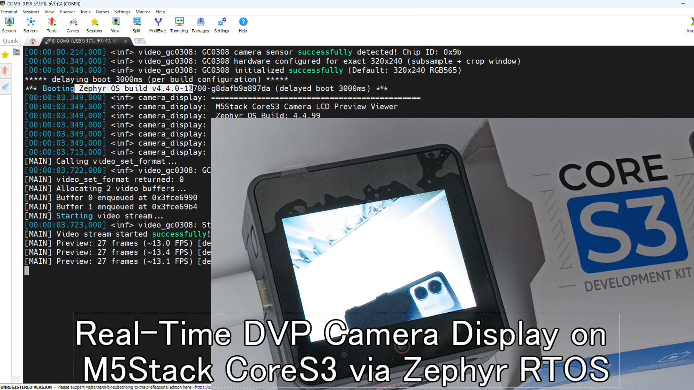
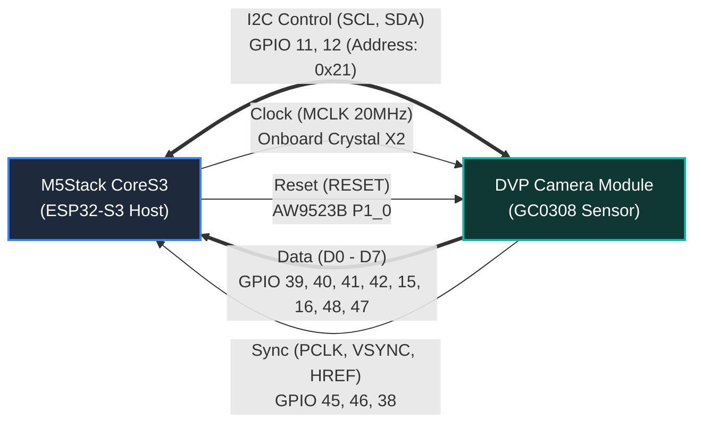
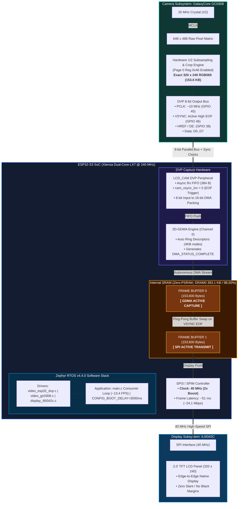

# M5Stack CoreS3 DVP Camera & Display Support for Zephyr RTOS

[](https://zephyrproject.org/)
[](https://docs.m5stack.com/en/core/CoreS3)
[-green.svg)](https://www.galaxycore.com/)
[-teal.svg)](https://docs.m5stack.com/en/core/CoreS3)
[](https://youtu.be/SE-EuWjXOFA)
[](LICENSE)

An open-source implementation, driver, and application suite for the onboard **GalaxyCore GC0308** CMOS camera sensor and built-in **ILI9342C TFT LCD** display on the **M5Stack CoreS3** (ESP32-S3) running **Zephyr RTOS**.

Featuring a **Zero-PSRAM double-buffering DMA architecture**, this project achieves real-time, zero-tearing preview streaming at **13.4 FPS** exclusively utilizing the ESP32-S3's internal SRAM.

---

## Live Demonstration

[](https://youtu.be/SE-EuWjXOFA)

📺 **Watch the video demonstration on YouTube**: [https://youtu.be/SE-EuWjXOFA](https://youtu.be/SE-EuWjXOFA)  
*Demonstrates physical hardware reboot, 3000ms delayed boot banner capture, sensor probe verification, and continuous ~13.4 FPS live LCD preview streaming without tearing.*


---

## Repository Structure

```text
cores3_camera/
├── .gitignore                          # Git ignore rules for Zephyr & build artifacts
├── LICENSE                             # Apache License 2.0
├── README.md                           # Main project documentation (this file)
├── img/                                # Architectural diagrams and demo photos
│   ├── cores3_demo_1.png
│   ├── cores3_demo_2.png
│   ├── cores3_demo_3.png
│   └── cores3_dvp_lcd_block_diagram.png
└── src/
    ├── camera_connect/                 # Phase 1: Camera I2C Probe & Verification Test
    │   ├── CMakeLists.txt
    │   ├── prj.conf
    │   ├── boards/                     # Devicetree overlay for camera pinmux
    │   ├── drivers/video/              # GC0308 Zephyr video driver
    │   ├── src/main.c                  # I2C probe & Chip ID verification app
    │   └── README.md
    └── camera_display/                 # Phase 2: Live LCD Camera Preview Viewer (Main App)
        ├── CMakeLists.txt
        ├── prj.conf                    # Double-buffering & boot delay configuration
        ├── boards/                     # Devicetree overlay (40MHz SPI + DVP)
        ├── drivers/video/              # GC0308 driver with 320x240 Crop Window Mode
        ├── src/main.c                  # Zero-PSRAM Double-Buffer LCD Viewer
        └── README.md
```

---

## Hardware Interface & Wiring Diagram

The GC0308 sensor is wired directly to the ESP32-S3 host via an 8-bit parallel Digital Video Port (DVP), an I2C (SCCB) bus, and dedicated clock/reset circuits.



### Complete Pin Assignment Table

| Function | Signal Name | CoreS3 Physical Pin | Direction | Description |
| :--- | :--- | :--- | :---: | :--- |
| **Data Bus** | `D0` | **GPIO 39** | Camera -> ESP32-S3 | DVP Data bit 0 (Schematic: CAM_D2) |
| | `D1` | **GPIO 40** | Camera -> ESP32-S3 | DVP Data bit 1 (Schematic: CAM_D3) |
| | `D2` | **GPIO 41** | Camera -> ESP32-S3 | DVP Data bit 2 (Schematic: CAM_D4) |
| | `D3` | **GPIO 42** | Camera -> ESP32-S3 | DVP Data bit 3 (Schematic: CAM_D5) |
| | `D4` | **GPIO 15** | Camera -> ESP32-S3 | DVP Data bit 4 (Schematic: CAM_D6) |
| | `D5` | **GPIO 16** | Camera -> ESP32-S3 | DVP Data bit 5 (Schematic: CAM_D7) |
| | `D6` | **GPIO 48** | Camera -> ESP32-S3 | DVP Data bit 6 (Schematic: CAM_D8) |
| | `D7` | **GPIO 47** | Camera -> ESP32-S3 | DVP Data bit 7 (Schematic: CAM_D9) |
| **Sync Clocks**| `PCLK` | **GPIO 45** | Camera -> ESP32-S3 | Pixel sampling clock (~10 MHz) |
| | `VSYNC`| **GPIO 46** | Camera -> ESP32-S3 | Frame boundary / EOF sync (Active-High) |
| | `HREF` | **GPIO 38** | Camera -> ESP32-S3 | Horizontal row data valid / DE |
| **Master Clock**| `MCLK`| **Crystal X2** | CoreS3 -> Camera | Dedicated 20 MHz onboard oscillator (No GPIO used) |
| **I2C / SCCB** | `SCL` | **GPIO 11** | ESP32-S3 -> Camera | I2C0 serial clock |
| | `SDA` | **GPIO 12** | Bidirectional | I2C0 serial data (7-bit Address: `0x21`) |
| **HW Reset** | `RESET`| **AW9523B P1_0** | CoreS3 -> Camera | Active-Low reset controlled via I/O expander |
| **Power Rails**| `VDDCAM`| **AXP2101 ALDO3** (3.3V)| Power Management | Camera I/O supply |
| | `AVDD` | **AXP2101 BLDO1** (2.8V)| Power Management | Camera analog array supply |
| | `DVDD` | **AXP2101 BLDO2** (3.3V)| Power Management | Camera core digital supply |
| | `BACKLIGHT`| **AXP2101 DLDO1** (3.3V)| Power Management | ILI9342C display backlight supply |

---

## System Architecture & Data Pipeline




---

## Key Technical Achievements

### 1. Hardware Crop Window Alignment (Exact 320x240)
- **The Problem**: In raw 1/2 subsample mode from the active 648x488 pixel matrix without cropping, the GC0308 sensor emits **324x244** pixels (158,112 bytes) rather than native **320x240** (153,600 bytes). This created a 4-pixel/line progressive diagonal slant, a black margin on the right, and truncated bottom scanlines when the 153.6 KB DMA descriptor buffer ran out early.
- **The Solution**: Configured **Crop Window Mode** in [`drivers/video/gc0308.c`](src/camera_display/drivers/video/gc0308.c) via Page 0 register `0x46 = 0x80` (`X0=0`, `Y0=0`, `Width=320`, `Height=240`). Output is cropped to precisely **153,600 bytes**, producing an edge-to-edge image with zero skew.

### 2. Zero-PSRAM Double-Buffering
- **The Problem**: Single-buffer DMA restart mid-frame caused split-screen tearing and inverted high/low RGB565 bytes (solarized psychedelic colors).
- **The Solution**: Implemented hardware double-buffering entirely in ESP32-S3 internal SRAM:
  - Video pool size: `CONFIG_VIDEO_BUFFER_POOL_HEAP_SIZE=308000` (two 153.6 KB frame buffers).
  - Main stack optimized to 4 KB (`CONFIG_MAIN_STACK_SIZE=4096`).
  - Total DRAM usage: **393.1 KB / 399.1 KB (98.50%)** — zero external PSRAM required.
  - While Buffer 0 is being captured by GDMA, Buffer 1 is simultaneously pushed to the display over SPI.

### 3. Display SPI Clock Doubled to 40 MHz
- Default 20 MHz SPI required ~85 ms to write a 153.6 KB frame.
- Overriding the SPI controller to **40 MHz** in DeviceTree reduced display transfer latency to **51 ms**, enabling steady-state rendering at **13.4 FPS**.

### 4. Serial Boot Delay (`CONFIG_BOOT_DELAY=3000`)
- Because the ESP32-S3 internal USB-Serial/JTAG controller resets with the SoC, Windows requires ~1.0-1.5s to re-enumerate `COM9`.
- Setting `CONFIG_BOOT_DELAY=3000` holds kernel boot banner output for 3 seconds, ensuring initial Zephyr version and probe logs are captured by MobaXterm, Tera Term, or serial loggers.

---

## Quick Start (Build & Flash)

### 1. Environment Setup
Activate the Zephyr virtual environment in PowerShell:
```powershell
cd $env:USERPROFILE
.\zephyrproject\.venv\Scripts\Activate.ps1
```

### 2. Build the Camera Display Application
```powershell
west build -p auto -b m5stack_cores3/esp32s3/procpu src/camera_display -d src/camera_display/build
```

### 3. Flash to M5Stack CoreS3
Connect your M5Stack CoreS3 via USB-C (COM9) and flash:
```powershell
west flash -d src/camera_display/build --esp-device COM9 --esp-baud-rate 921600
```

### 4. Monitor Serial Output
Open your serial terminal (MobaXterm or Tera Term) at **115200 bps** on `COM9`. Upon reset, you will observe:
```text
[00:00:03.013,000] <inf> video_gc0308: GC0308 camera sensor successfully detected! Chip ID: 0x9b
[00:00:03.148,000] <inf> video_gc0308: GC0308 hardware configured for exact 320x240 (subsample + crop window)
[00:00:03.148,000] <inf> video_gc0308: GC0308 initialized successfully (Default: 320x240 RGB565)
*** Booting Zephyr OS build v4.4.0-12700-g8dafb9a897da (delayed boot 3000ms) ***
[00:00:03.148,000] <inf> camera_display: ==============================================
[00:00:03.148,000] <inf> camera_display:  M5Stack CoreS3 Camera LCD Preview Viewer     
[00:00:03.148,000] <inf> camera_display:  Zephyr OS Build: 4.4.99
[00:00:03.148,000] <inf> camera_display: ==============================================
[00:00:03.148,000] <inf> camera_display: Display device ready: ili9342c@0
[00:00:03.512,000] <inf> camera_display: Camera device ready: lcd_cam_dvp
[MAIN] Preview: 27 frames (~13.4 FPS) [deq=0ms, disp=51ms, enq=0ms] INT_RAW=0x0 G46=1
[MAIN] Preview: 27 frames (~13.1 FPS) [deq=47ms, disp=51ms, enq=1ms] INT_RAW=0x0 G46=1
```

---

## Performance Summary Table

| Metric | Real-World Value | Engineering Note |
| :--- | :---: | :--- |
| **Preview Resolution** | **320 x 240** | RGB565 (16 bits/pixel, 153,600 bytes/frame) |
| **Sustained Frame Rate** | **~13.4 FPS** | Zero dropped frames, zero DMA underflows |
| **Display SPI Clock** | **40 MHz** | 51 ms full-screen transfer time |
| **Camera PCLK** | **~10 MHz** | ~98 ms frame interval (~10.2 FPS raw) |
| **Internal DRAM0 Used** | **393.1 KB / 399.1 KB** | **98.50%** — Fits inside internal SRAM |
| **External PSRAM** | **0 KB** | Zero PSRAM dependency, no bus contention |

---

## License

This project is licensed under the **Apache License, Version 2.0**. See the [LICENSE](LICENSE) file for the full text.
