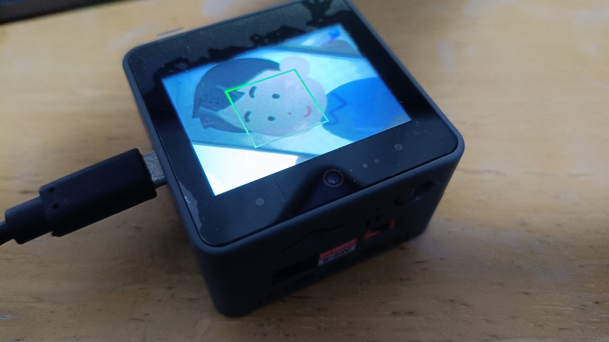
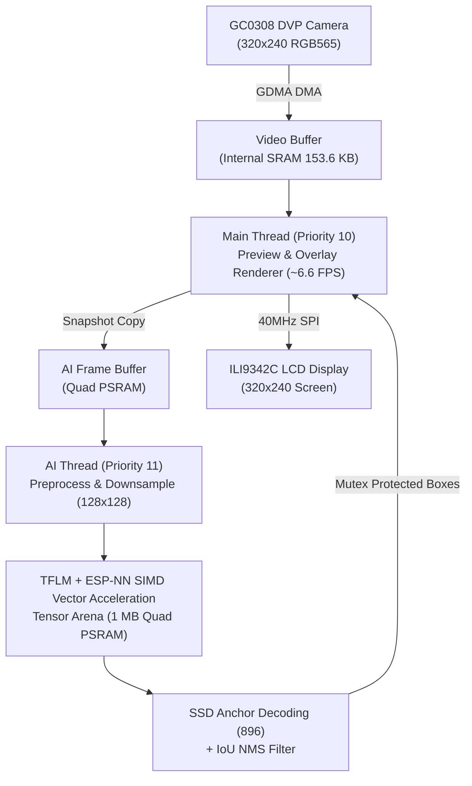

# M5Stack CoreS3 BlazeFace AI Face Detection on Zephyr RTOS

This project implements real-time on-device face detection on the **M5Stack CoreS3** (ESP32-S3) running **Zephyr RTOS v4.4.99**, powered by **TensorFlow Lite for Microcontrollers (TFLM)**, **Google MediaPipe BlazeFace INT8**, and hardware-accelerated by **Espressif ESP-NN (Xtensa PIE SIMD Vector Instructions)**.

[](https://youtu.be/vcJoFc5fCvE)

📺 **YouTube Demo Video**: [https://youtu.be/vcJoFc5fCvE](https://youtu.be/vcJoFc5fCvE)

---

## Performance Benchmark on Physical Hardware

| Kernel Mode | AI Inference Latency | Speedup | Live Camera Preview FPS | User Experience |
| :--- | :---: | :---: | :---: | :--- |
| **TFLM Reference C++** | **22,544 ms** (~22.5 s) | 1.0x | ~6.6 FPS | Noticeable delay (25-45s) before Bbox appears |
| **ESP-NN Xtensa PIE SIMD** | **1,126 ms** (~1.1 s) | **20.0x Faster** | **~6.6 FPS** | **Near real-time green Bbox face tracking** |

---

## Key Highlights

- **OS / RTOS**: Native Zephyr RTOS v4.4.99 (maintaining built-in GC0308 DVP camera & ILI9342C SPI LCD display drivers).
- **Inference Engine**: TensorFlow Lite for Microcontrollers (TFLM) integrated directly with Espressif **ESP-NN** Xtensa PIE assembly & optimized SIMD kernels (`conv`, `depthwise_conv`, `add`, `pooling`, `quantize`).
- **AI Model**: BlazeFace INT8 (128x128 RGB input, 896 SSD anchors, 189 KB Flash footprint).
- **Asynchronous Dual-Thread Pipeline**:
  - **Thread 1 (`main` / Preview Thread, Priority 10)**: Real-time 320x240 RGB565 DVP camera acquisition via DMA and ILI9342C SPI preview at ~6.6 FPS with real-time green bounding box overlay (`COLOR_GREEN = 0xE007`).
  - **Thread 2 (`ai_thread` / Inference Worker, Priority 11)**: Center crops (240x240 -> 128x128), normalizes pixels, invokes TFLM inference in the background (~1.1s), decodes 896 SSD anchors, and runs IoU Non-Maximum Suppression (NMS).
- **Optimized Memory Allocation**:
  - **Internal SRAM (`dram0_0_seg`)**: Dedicated entirely to high-speed GC0308 DMA video buffers (153.6 KB) and kernel stacks. Leaves over **120 KB free SRAM**.
  - **8MB Quad PSRAM (`.ext_ram.bss`)**: Houses the 1 MB TFLM Tensor Arena (`s_tensor_arena`) and AI snapshot buffer (`s_ai_frame`). Consumes 0 bytes of internal SRAM.

---

## Memory Footprint (Build Stats)

```text
Memory region         Used Size  Region Size  %age Used
           FLASH:      577620 B   16776960 B      3.44%
     iram0_0_seg:       57828 B     399108 B     14.49%
     dram0_0_seg:      278680 B     399108 B     69.83% (~120 KB free SRAM!)
    ext_dram_seg:       2646 KB        32 MB      8.07% (Quad PSRAM)
```

---

## Architecture Diagram



---

## How to Build and Flash

### 1. Build
Open PowerShell and run:
```powershell
.\build_app.ps1
```

### 2. Flash
Connect M5Stack CoreS3 via USB-C and run:
```powershell
.\flash_app.ps1
```

### 3. Serial Monitor
```powershell
.\monitor_app.ps1
```

### Measured Real-World Log Output:
```text
[MAIN] Initializing BlazeFace Detector...
[BLAZEFACE] Initializing BlazeFace Face Detector...
[BLAZEFACE] TFLM Model initialized successfully!
[BLAZEFACE] Input tensor: dims=[1,128,128,3] type=1 bytes=196608
[BLAZEFACE] Arena used: 603152 / 1048576 bytes
[BLAZEFACE] Output 0: dims=[1,512,16] type=1 bytes=32768 scale_x1000=0 zp=0
[BLAZEFACE] Output 1: dims=[1,512,1] type=1 bytes=2048 scale_x1000=0 zp=0
[BLAZEFACE] Output 2: dims=[1,384,1] type=1 bytes=1536 scale_x1000=0 zp=0
[BLAZEFACE] Output 3: dims=[1,384,16] type=1 bytes=24576 scale_x1000=0 zp=0
[MAIN] blazeface_detector_init returned: 0
[00:00:03.775,000] <inf> camera_blazeface: Camera ready: lcd_cam_dvp
[00:00:03.780,000] <inf> camera_blazeface: [AI_THREAD] Background AI inference thread started
[00:00:03.790,000] <inf> video_gc0308: GC0308 hardware configured for exact 320x240 (subsample + crop window)
[00:00:03.798,000] <inf> video_gc0308: Stream started
[00:00:03.802,000] <inf> camera_blazeface: Video stream started successfully! Starting live preview & AI loop...
[APP] Preview: 14 frames (~6.7 FPS) | Faces: 0 | AI Infer: 1126 ms
[APP] Preview: 14 frames (~6.6 FPS) | Faces: 0 | AI Infer: 1126 ms
[BLAZEFACE] Detected 1 face candidate(s)
[APP] Preview: 14 frames (~6.6 FPS) | Faces: 1 | AI Infer: 1126 ms
```
