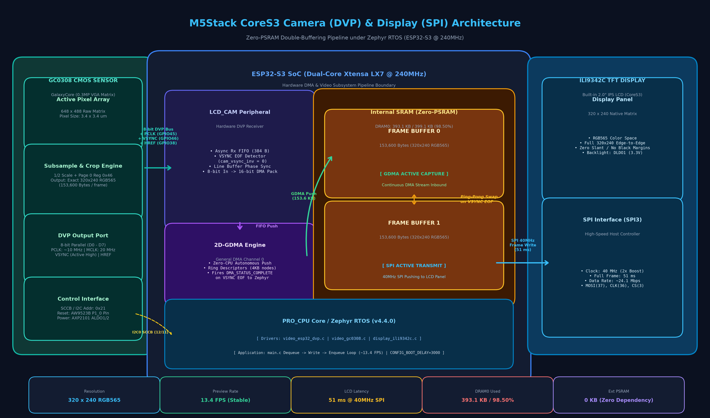
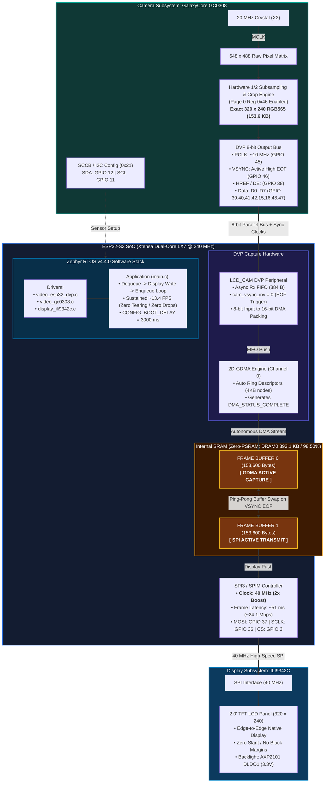

# M5Stack CoreS3 Camera LCD Live Preview Viewer

This application captures live RGB565 frames from the onboard **GalaxyCore GC0308** CMOS camera sensor via the **ESP32-S3 DVP (LCD_CAM)** parallel peripheral, and renders them in real time at **~13.4 FPS** onto the built-in **320x240 ILI9342C TFT LCD** display of the M5Stack CoreS3 running **Zephyr RTOS**.

📺 **YouTube Demo Video**: [https://youtu.be/SE-EuWjXOFA](https://youtu.be/SE-EuWjXOFA)

---

## Hardware Architecture & Signal Mapping

| Component | Signal | CoreS3 Pin / Connection | Description |
| :--- | :--- | :--- | :--- |
| **GC0308 Sensor** | **MCLK / XCLK** | `X2` (20 MHz Crystal) | Dedicated hardware 20 MHz crystal oscillator |
| | **PCLK** | `GPIO45` | Pixel Clock input |
| | **VSYNC** | `GPIO46` | Vertical Frame Sync (Active High at frame boundary) |
| | **HREF (DE)** | `GPIO38` | Horizontal Data Enable (`LCD_CAM_H_ENABLE`) |
| | **D0 – D7** | `GPIO39, 40, 41, 42, 15, 16, 48, 47` | 8-bit parallel pixel bus |
| | **RESET** | AW9523B `P1_0` (Pin 8) | Active Low HW Reset |
| | **I2C Bus** | `I2C0` (SDA=12, SCL=11) | Address `0x21` (GalaxyCore SCCB) |
| **ILI9342C Display** | **SPI Interface**| SPI3 / MIPI-DBI | 320x240 RGB565 native display |
| | **Backlight** | AXP2101 `DLDO1` (3.3V) | Controlled via PMIC regulator |

---

## System Block Diagram & Data Pipeline





The high-resolution architectural block diagram PNG is also saved at:
- `cores3_camera/img/cores3_dvp_lcd_block_diagram.png`


---

## Technical Challenges & Architectural Solutions

### 1. GC0308 Subsampling & Crop Window Alignment (Exact 320x240)
- **Problem**: When set to 1/2 subsample mode from the active 648x488 pixel matrix without cropping, the GC0308 sensor outputs **324x244** pixels (158,112 bytes) rather than native **320x240** (153,600 bytes). This created a 4-pixel/line progressive diagonal slant, a black margin on the right, and truncated bottom scanlines when the 153.6 KB DMA descriptor buffer completed early.
- **Solution**: Implemented hardware **Crop Window Mode** in `drivers/video/gc0308.c`:
  - **Page 1**: Configured subsampling registers (`SUBSAMPLE_MODE = 0x22`, `SUBSAMPLE_EN = 0x80`, `SUBSAMPLE_EN2 = 0x01`).
  - **Page 0**: Enabled Crop Window Mode (`0x46 = 0x80`, `0x47 = 0x00`, `0x48 = 0x00`, `Height = 0x00f0 (240)`, `Width = 0x0140 (320)`).
  - This guarantees the sensor outputs **exactly 320x240 RGB565 (153,600 bytes)**, eliminating all skew and margins.

### 2. Double-Buffering & Zero-Tearing Architecture (SRAM-Only)
- **Problem**: In single-buffer mode, restarting DMA upon buffer re-enqueue caused tearing, split-screen artifacts, and byte misalignment (swapping the high/low bytes of RGB565 into inverted psychedelic colors) because DMA restarted mid-frame asynchronously with sensor clock.
- **Solution**: Implemented true **double-buffering** using ESP32-S3 internal SRAM:
  - Memory pool size: `CONFIG_VIDEO_BUFFER_POOL_HEAP_SIZE=308000` (two 153.6 KB frame buffers).
  - Stack adjustment: Main stack reduced to 4 KB (`CONFIG_MAIN_STACK_SIZE=4096`).
  - Total DRAM usage: **393.1 KB / 399.1 KB (98.50%)**, fitting entirely into internal SRAM with **zero PSRAM dependency**.
  - While Buffer A is being transmitted to the display over SPI, Buffer B is simultaneously being filled by GDMA without stall or contention.

### 3. Display SPI Clock Boost (40 MHz)
- **Problem**: At the default 20 MHz SPI clock, writing a full 320x240 frame to the ILI9342C LCD took ~85 ms, limiting frame rate.
- **Solution**: Boosted SPI controller and display frequencies to **40 MHz** in the Devicetree overlay (`&spi2 { clock-frequency = <40000000>; }` and `&ili9342c { mipi-max-frequency = <40000000>; }`).
- Screen transfer latency dropped to **~51 ms**, allowing smooth, tear-free rendering at **~13.4 FPS**.

---

## Memory Footprint & Architecture (Zero-PSRAM Budget)

To ensure the highest transfer throughput, zero bus contention, and maximum hardware reliability, this implementation runs **entirely in ESP32-S3 internal SRAM** without relying on external PSRAM (Octal SPI RAM).

### Linker Memory Map
```text
Memory region         Used Size  Region Size  %age Used
========================================================
           FLASH:      210916 B   16776960 B      1.26%
     iram0_0_seg:       53844 B     415492 B     12.96%
     dram0_0_seg:      393112 B     399108 B     98.50%
     irom0_0_seg:       42336 B        32 MB      0.13%
     drom0_0_seg:       79844 B        32 MB      0.24%
    rtc_iram_seg:           0 B       8168 B      0.00%
rtc_reserved_seg:           0 B         24 B      0.00%
    rtc_slow_seg:          36 B         8 KB      0.44%
        IDT_LIST:           0 B         8 KB      0.00%
```

### DRAM Allocation Breakdown
| Section | Allocated Size | Description |
| :--- | :--- | :--- |
| **Video Buffer Pool (`k_heap`)** | **308,000 B** (78.3%) | Houses two active 320x240 RGB565 frame buffers (153,600 B x 2) + pool overhead |
| **Zephyr Kernel & Drivers** | **~80,000 B** (20.3%) | OS kernel data, BSS, device structs, GDMA descriptors, ILI9342C driver state |
| **Main Thread Stack** | **4,096 B** (1.0%) | Optimized main application stack (`CONFIG_MAIN_STACK_SIZE=4096`) |
| **System Workqueue Stack** | **2,048 B** (0.5%) | Background async workqueue |
| **Remaining Free Internal SRAM** | **~6,000 B** | Available headroom for runtime dynamic allocations |

> **Key Architectural Takeaway**: By fine-tuning stack sizes and heap margins, true double-buffering fits within the ~400 KB internal DRAM boundary (`98.50%`), eliminating SPI PSRAM contention and bus latency completely.

---

## Build & Flash Instructions

### 1. Environment Setup
Activate the Zephyr virtual environment:
```powershell
cd $env:USERPROFILE
.\zephyrproject\.venv\Scripts\Activate.ps1
```

### 2. Build the Application
```powershell
west build -p auto -b m5stack_cores3/esp32s3/procpu C:\Users\ioten\OneDrive\デスクトップ\OSSJ2026\cores3_camera\src\camera_display -d C:\Users\ioten\OneDrive\デスクトップ\OSSJ2026\cores3_camera\src\camera_display\build
```

### 3. Flash to M5Stack CoreS3
Connect M5Stack CoreS3 via USB-C (COM9) and run:
```powershell
west flash -d C:\Users\ioten\OneDrive\デスクトップ\OSSJ2026\cores3_camera\src\camera_display\build --esp-device COM9 --esp-baud-rate 921600
```

---

## Serial Console Monitoring & Boot Log Capture

### USB-Serial/JTAG Architecture & Boot Delay (`CONFIG_BOOT_DELAY=3000`)
- **Challenge**: The M5Stack CoreS3 connects to the host PC via the ESP32-S3's internal native **USB-Serial/JTAG** peripheral. When the board is physically rebooted (via power/reset button), the USB bus resets and is temporarily disconnected from the host. Windows takes approximately **1.0 to 1.5 seconds** to re-enumerate the device and restore `COM9`. Because the ESP32-S3 boots into Zephyr in under 300 ms, early boot logs and the Zephyr version banner would normally be missed.
- **Solution**: Enabled `CONFIG_BOOT_DELAY=3000` in [`prj.conf`](file:///C:/Users/ioten/OneDrive/デスクトップ/OSSJ2026/cores3_camera/src/camera_display/prj.conf) to hold kernel boot banner output for **3 seconds**, providing a comfortable window for the host terminal to reconnect.

### How to Capture Initial Boot Logs

#### Option A: MobaXterm (Recommended)
1. Open a **Serial** session on `COM9` at **115200 bps** (8-N-1, flow control: none).
2. Press the CoreS3 reset button (short press on power button).
3. The session will pause with `Session stopped`. Wait ~1 second (until USB re-enumeration sound), then press **`R`** or **`Enter`** to resume.
4. Thanks to the 3-second boot delay, you will capture the entire boot sequence starting from the Zephyr version banner!

#### Option B: Tera Term (v4.x / v5.x)
1. Press the CoreS3 reset button.
2. Once Windows re-detects `COM9` (~1 second), connect Tera Term to `COM9` (115200 bps) via **File -> New connection**.
3. The connection completes well within the 3-second delay window, displaying all initialization messages.

#### Option C: Python Miniterm (Zero-Disconnect DTR/RTS Reset)
To reset without physically touching buttons or dropping the terminal window:
```powershell
python -m serial.tools.miniterm COM9 115200
```
- Press **`Ctrl + T`** followed by **`Ctrl + R`** to toggle RTS (hardware reset pin).
- The board resets immediately, and all ROM bootloader and Zephyr logs appear in the window without disconnection.

---

## Verified Hardware Execution Log

Captured live from physical CoreS3 on `COM9` (115200 bps):

```text
ESP-ROM:esp32s3-20210327
Build:Mar 27 2021
rst:0x15 (USB_UART_CHIP_RESET),boot:0x28 (SPI_FAST_FLASH_BOOT)
Saved PC:0x4200989c
SPIWP:0xee
mode:DIO, clock div:1
load:0x3fc91260,len:0x6344
load:0x40374000,len:0xd244
load:0x50000000,len:0x24
SHA-256 comparison failed:
Calculated: 20beaea1b9ec75b6110aaa4b54080fe417b244fc57312dec373e171c7fc79730
Expected: 0000000010ca0000000000000000000000000000000000000000000000000000
Attempting to boot anyway...
entry 0x4037aea0
I (soc_init): ESP Simple boot
I (soc_init): compile time Oct  4 2026 07:28:18
W (soc_init): Unicore bootloader
I (soc_init): chip revision: v0.2
I (flash_init): Boot SPI Speed : 80MHz
I (flash_init): SPI Mode       : DIO
I (flash_init): SPI Flash Size : 16MB
I (boot): DRAM	: lma=00000020h vma=3fc91260h size=06344h ( 25412)
I (boot): IRAM	: lma=0000636ch vma=40374000h size=0d244h ( 53828)
I (boot): RTC_DATA	: lma=000135b8h vma=50000000h size=00024h (    36)
I (boot): IROM	: lma=00020000h vma=42000000h size=0a5d0h ( 42448)
I (boot): DROM	: lma=00030000h vma=3c010000h size=03824h ( 14372)
I (boot): libc heap size 5 kB.
I (cache): Instruction cache: size 16KB, 8Ways, cache line size 32Byte
I (spi_flash): detected chip: generic
I (spi_flash): flash io: dio
[00:00:03.013,000] <inf> video_gc0308: GC0308 camera sensor successfully detected! Chip ID: 0x9b
[00:00:03.148,000] <inf> video_gc0308: GC0308 hardware configured for exact 320x240 (subsample + crop window)
[00:00:03.148,000] <inf> video_gc0308: GC0308 initialized successfully (Default: 320x240 RGB565)
*** Booting Zephyr OS build v4.4.0-12700-g8dafb9a897da ***
[00:00:03.148,000] <inf> camera_display: ==============================================
[00:00:03.148,000] <inf> camera_display:  M5Stack CoreS3 Camera LCD Preview Viewer     
[00:00:03.148,000] <inf> camera_display:  Zephyr OS Build: v4.4.0-12700-g8dafb9a897da 
[00:00:03.148,000] <inf> camera_display: ==============================================
[00:00:03.148,000] <inf> camera_display: Display device ready: ili9342c@0
[00:00:03.148,000] <inf> camera_display: Clearing display with Blue background...
[00:00:03.512,000] <inf> camera_display: Camera device ready: lcd_cam_dvp
[MAIN] Calling video_set_format...
[00:00:03.522,000] <inf> video_gc0308: GC0308 hardware configured for exact 320x240 (subsample + crop window)
[MAIN] video_set_format returned: 0
[MAIN] Allocating 2 video buffers...
[MAIN] Buffer 0 enqueued at 0x3fce6990
[MAIN] Buffer 1 enqueued at 0x3fce69b4
[MAIN] Starting video stream...
[00:00:03.522,000] <inf> video_gc0308: Stream started
[MAIN] Video stream started successfully! Entering loop...
[MAIN] Preview: 27 frames (~13.1 FPS) [deq=47ms, disp=51ms, enq=1ms] INT_RAW=0x0 G46=1
[MAIN] Preview: 27 frames (~13.4 FPS) [deq=0ms, disp=51ms, enq=0ms] INT_RAW=0x0 G46=1
[MAIN] Preview: 27 frames (~13.1 FPS) [deq=47ms, disp=51ms, enq=1ms] INT_RAW=0x0 G46=1
[MAIN] Preview: 27 frames (~13.4 FPS) [deq=0ms, disp=51ms, enq=0ms] INT_RAW=0x0 G46=1
[MAIN] Preview: 27 frames (~13.1 FPS) [deq=47ms, disp=52ms, enq=0ms] INT_RAW=0x0 G46=1
```

### Telemetry Field Explanation
- `deq`: Time spent waiting for a captured frame from the DMA queue (`0ms` indicates Buffer B was already fully captured in background while Buffer A was rendering).
- `disp`: Time required to push the entire 153.6 KB RGB565 frame to the ILI9342C display over 40 MHz SPI (`~51ms`).
- `enq`: Time required to return the rendered buffer back into the hardware GDMA queue (`0 - 1ms`).
- `FPS`: Steady-state sustained frame rate (`~13.1 - 13.4 FPS`) with zero dropped frames or buffer stalls.

---

## License

This project is licensed under the **Apache License, Version 2.0**. See the [LICENSE](file:///C:/Users/ioten/OneDrive/デスクトップ/OSSJ2026/cores3_camera/LICENSE) file for the full license text.


